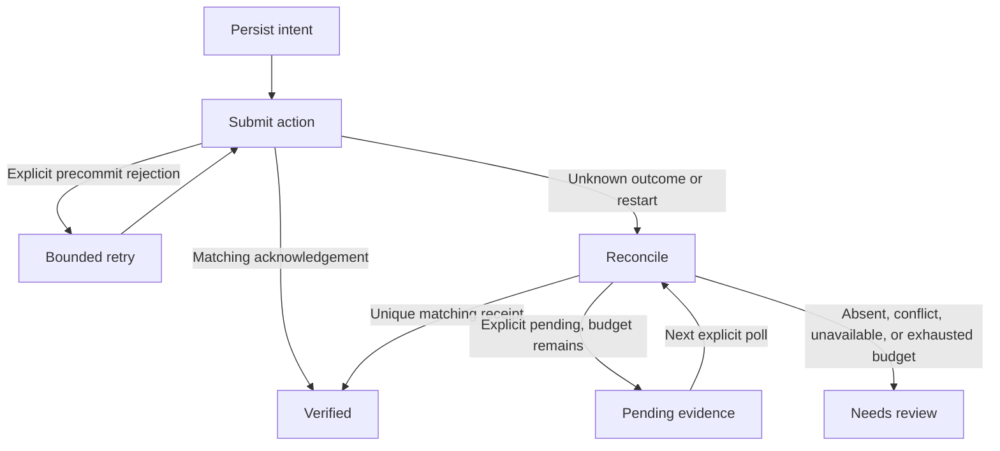

# Checkpoint

**An executable recovery laboratory for uncertain external actions.** Persist an intent, submit a synthetic invoice over HTTP, lose the acknowledgement, and investigate the destination before retrying. Compare this with a naive retry that creates a duplicate.

This is an independent portfolio research prototype inspired by browser-agent reliability problems. **It is not affiliated with Steel, has no Steel integration yet, and does not claim browser recovery validation.** All demonstrated actions use a controlled local HTTP merchant with fictional invoices. No real billing or account access occurs.

## Current milestone: runnable same-origin recovery service

Run `npm run dev` with Node.js 22+ and Python 3.11+ to open the interactive comparison on port 3000. The service executes the actual loopback HTTP/SQLite recovery experiment for each request, using independent merchants and journals for the naive baseline and reconciliation. The browser-facing interface displays actual journal traces, pending polling and labeled evaluation-oracle counts. It does not automate a browser or call Steel.

The underlying destination binding, crash-atomic migration and single-host ownership checks remain intact. The service adds bounded worker isolation, strict JSON requests, capacity/rate limits, cleanup after disconnect/timeout, safe same-origin assets and graceful shutdown. Run `npm test` and `npm run smoke`; see [deployment.md](deployment.md) for exact API, runtime/container setup and operational limits. Local verification passes 26 existing Python tests plus 16 HTTP/lifecycle tests and nine frontend evidence tests. Docker/hosted deployment and Steel integration remain unverified.

## Run

Python 3.11+ on Linux/macOS (POSIX `flock`); no runtime dependencies or API keys. From the repository root:

```sh
python -m unittest discover -s tests -v
python -m checkpoint demo
python -m checkpoint portal --port 8765 --visibility-delay 5 --fault after_commit
```

The demo starts ephemeral localhost HTTP services, creates temporary SQLite stores, executes twelve cases, emits JSON, and cleans up. `portal` instead runs a persistent localhost merchant at the printed URL, stores fictional records under `.checkpoint-state/`, and stops with Ctrl+C. Its form creates a fictional invoice and its lookup/read-only-state controls display visible evidence. A lost acknowledgement is shown as unknown, not an invitation to retry. The portal does not invoke the recovery journal; it is the controlled destination for a future browser adapter. `python -m checkpoint --help` documents the CLI. Docker is optional:

```sh
docker build -t checkpoint-lab .
docker run --rm -p 3000:3000 checkpoint-lab
```

## What happens

1. A SQLite transaction commits the intent and `executing` state **before** sending the external request.
2. A matching destination acknowledgement verifies completion.
3. A fixture-specific explicit rejection before commit authorizes one retry.
4. A missing acknowledgement enters reconciliation. One matching durable receipt verifies success without resubmission.
5. Missing lookup capability, an ordinary empty search, duplicate matches, or conflicting evidence enters `needs_review` without resubmitting.
6. A destination-specific explicit `pending` response can keep the intent `pending` while delayed evidence becomes visible. Each `run` performs at most one lookup. Its persisted pending count reaches `needs_review` at the configured budget; the core Runner schedules no background polling or side-effect retry. The web worker calls explicit reconciliation in a bounded loop when the destination reports pending evidence. A later explicit lookup can still verify a unique receipt.
7. Restarting against an `executing` journal entry reconciles first. A test kills a real child process after submission and recovers from the persisted journal in the parent.



Every transition has a durable event record with its reason. Amounts are positive integer minor units; the same reference cannot be reused for a different amount. A journal is immutably bound to its first canonical loopback HTTP origin before business actions. A different destination is rejected even when an intent is already verified. Schema creation and the legacy safety marker commit atomically. Reopening any populated journal without destination evidence is rejected for inspection/export rather than silently adopted, including artifacts from interrupted older migrations. Low-level callers must bind the destination before external actions or persisting work that needs recovery after a restart. Use a stable port for a destination that needs to survive server restarts; changing the port changes the origin.

A nonblocking OS file lock owns the canonical journal path for the complete `run` or explicit `reconcile`. A competing process receives `OwnershipBusy` before planning or submitting. The kernel releases ownership on normal exit or process death; a leftover lock file is not ownership and must not be deleted to bypass a running owner. Low-level `Journal` methods are storage primitives, not an alternative concurrency-safe runner API. Hard-link aliases, network filesystems, and distributed actors are unsupported.

## Experiment

Two policies run against three destination capabilities and two faults:

| Dimension | Cases |
| --- | --- |
| Policy | Naive retry; journal plus reconciliation |
| Destination | Observable search; opaque without lookup; destination-enforced idempotent reference |
| Fault | Explicit rejection before commit; commit followed by connection closure before acknowledgement |

The benchmark reads the merchant's internal records **only after execution**, as ground truth. The recovery engine sees only its normal HTTP submission and lookup endpoints. This prevents privileged test knowledge from leaking into recovery decisions.

Reported fields include final state, attempts, records, duplicates, and elapsed milliseconds. `records` is the business outcome; `state` is what the runner knows. They can legitimately differ: an opaque committed action has one record while the runner correctly requests review.

### Observed first run

The sample in [benchmarks/fixture-recovery.json](benchmarks/fixture-recovery.json) was generated locally on 2026-10-29. Twelve deterministic cases are illustrative checks, not statistical production benchmarks. In commit-then-disconnect scenarios:

| Destination | Naive retry | Reconciliation |
| --- | --- | --- |
| Observable | 2 invoices, 1 duplicate | 1 invoice, verified, 1 attempt |
| Opaque | 2 invoices, 1 duplicate | 1 invoice, needs review, 1 attempt |
| Idempotent | 1 invoice, 2 attempts | 1 invoice, verified, 1 attempt |

Both policies recover the explicit precommit rejection with two attempts and one invoice in all three destination modes. Ten tests passed, including true process death, duplicate receipts, conflicting destination receipts, reference conflicts, and absence that cannot prove nonexecution. CI repeats tests and the demo; local results do not imply the hosted workflow has run.

Across six runs per policy, naive retry reported six verified outcomes but created eight records (two duplicates). Reconciliation verified five outcomes and requested review for one opaque outcome, producing six records with zero duplicates. These are controlled fixture observations, with no reliability guarantee for arbitrary destinations.

## Research and differentiation

Steel already offers profiles, session context transfer, replay, and action traces. Browser Use already provides history replay. Rebuilding those features would overlap existing products. This project instead examines **whether a business action succeeded when its acknowledgement is missing**.

Primary sources consulted on 2026-10-29:

- [Steel Playwright integration](https://docs.steel.dev/integrations/playwright): connect to managed browsers over CDP.
- [Steel session lifecycle](https://docs.steel.dev/overview/sessions-api/session-lifecycle): released sessions cannot be reconnected.
- [Steel session configuration](https://docs.steel.dev/overview/sessions-api/configuration): profile persistence follows release and readiness; a crash does not guarantee the latest state was saved.
- [Steel agent trace API](https://docs.steel.dev/overview/agent-traces/api): timestamped actions and evidence, useful for a future adapter.
- [Steel reliability guidance](https://llms.steel.dev/articles/how-to-measure-browser-agent-reliability/): retries and missing evidence hide failure costs.
- [Browser Use developer guide](https://browser-use.com/developers): existing replay may already have executed earlier form submissions.
- [Temporal activity definition](https://github.com/temporalio/documentation/blob/main/docs/encyclopedia/activities/activity-definition.mdx): a worker may complete an action before crashing without reporting success; destination-side idempotency matters.

## Boundaries and next work

- This prototype is a **single-host local HTTP laboratory** with mutually exclusive process ownership through POSIX file locking. It is not a production agent, browser SDK, queue service, or deployed application. It has no distributed lease, destination fencing, or cross-host coordination.
- No generic exactly-once guarantee is possible here. The observable fixture's lookup is synchronous and reference matching is simple. Production reconciliation needs domain-specific evidence, uniqueness, authorization, and visibility assumptions.
- An empty lookup is deliberately not treated as permission to retry. This trades completion for an honest unresolved outcome. Human review is an explicit state, not an implemented approval interface.
- The retry permission comes from the fixture's explicit `committed: false` contract. A generic HTTP 503 must never be interpreted this way without such a guarantee.
- The fixture now supports delayed visibility via an explicit pending contract and a controllable clock in tests. This contract does not generalize to arbitrary portals. No automatic compensating action, secret management, authentication, or browser profile recovery is implemented. Lookup failures abstain rather than retry side effects.
- Receipts use one reference and amount; timestamps alone, screenshots alone, and an LLM's claim of success would not be sufficient evidence.
- Keep the journal and destination storage on durable disks for any persistent use. The demo intentionally uses disposable storage.
- A future Playwright/Steel adapter must perform submission and reconciliation through an actual UI, preserve session evidence, handle expired authentication, and separately report browser-level test results. HTTP tests cannot establish those properties.

## Structure

- `checkpoint/engine.py`: SQLite intent journal, HTTP client, bounded runner and reconciliation.
- `checkpoint/fixture.py`: merchant fixture with controlled faults and destination modes.
- `checkpoint/__main__.py`: twelve-case executable comparison.
- `tests/test_recovery.py`: the original failure, ambiguity, and process-restart tests.
- `tests/test_next_milestone.py`: destination binding, pending evidence, ownership contention/process death, malformed upstream responses, interrupted schema migration, and HTTP portal contract tests (including invalid Unicode rejection).
- `.github/workflows/ci.yml`: Python tests and demo; read-only repository permissions.

All code is standard-library Python. No proprietary source or user data is included.

## Next milestone verification

The added tests verify delayed evidence through multiple fresh runner instances without additional submissions; exhaustion preserves an unresolved outcome; a later matching receipt can resolve it. A spawned owner blocks a second process, and abrupt owner death releases the OS lock. Response objects, arrays, nulls, boolean numeric fields, and contradictory pending/record payloads are handled without inventing a successful outcome. The portal tests fetch its HTML, submit over real loopback HTTP, and check visible state; **they do not execute JavaScript in a browser**.

The next integration step is a Playwright adapter that drives this portal through its actual form and lookup controls, then an optional Steel session provider. Those results must be reported separately from these HTTP tests. The portal is deliberately loopback-only and unauthenticated, without production server protections; do not expose it to a public network.
