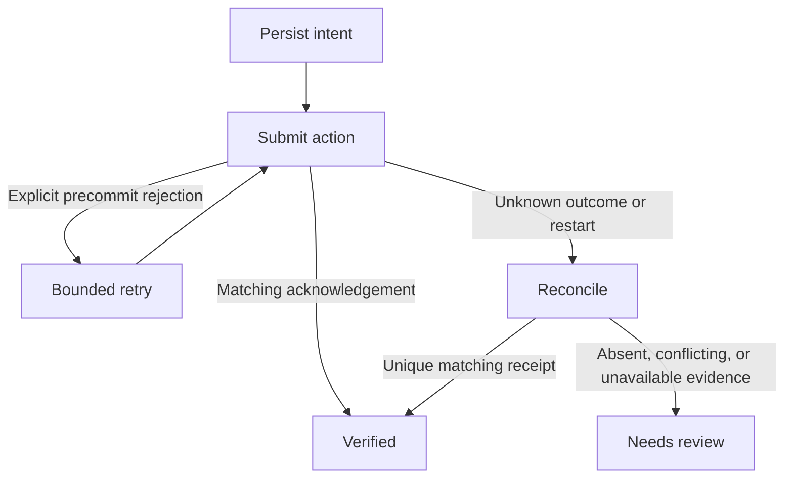

# Checkpoint

**An executable recovery laboratory for uncertain external actions.** Persist an intent, submit a synthetic invoice over HTTP, lose the acknowledgement, and investigate the destination before retrying. Compare this with a naive retry that creates a duplicate.

This is an independent portfolio research prototype inspired by browser-agent reliability problems. **It is not affiliated with Steel, has no Steel integration yet, and does not claim browser recovery validation.** All demonstrated actions use a controlled local HTTP merchant with fictional invoices. No real billing or account access occurs.

## Run

Python 3.11+; no runtime dependencies or API keys. From the repository root:

```sh
python -m unittest discover -s tests -v
python -m checkpoint demo
```

The demo starts ephemeral localhost HTTP services, creates temporary SQLite stores, executes twelve cases, emits JSON, and cleans up. `python -m checkpoint --help` documents the CLI. Docker is optional:

```sh
docker build -t checkpoint-lab .
docker run --rm checkpoint-lab
```

## What happens

1. A SQLite transaction commits the intent and `executing` state **before** sending the external request.
2. A matching destination acknowledgement verifies completion.
3. A fixture-specific explicit rejection before commit authorizes one retry.
4. A missing acknowledgement enters reconciliation. One matching durable receipt verifies success without resubmission.
5. Missing lookup capability, no visible record, duplicate matches, or conflicting evidence enters `needs_review` without resubmitting.
6. Restarting against an `executing` journal entry reconciles first. A test kills a real child process after submission and recovers from the persisted journal in the parent.



Every transition has a durable event record with its reason. Amounts are positive integer minor units; the same reference cannot be reused for a different amount. A single journal belongs to one fixed destination and one runner owner.

## Experiment

Two policies run against three destination capabilities and two faults:

| Dimension | Cases |
| --- | --- |
| Policy | Naive retry; journal plus reconciliation |
| Destination | Observable search; opaque without lookup; destination-enforced idempotent reference |
| Fault | Explicit rejection before commit; commit followed by connection closure before acknowledgement |

The benchmark reads the merchant's internal records **only after execution**, as ground truth. The recovery engine sees only its normal HTTP submission and lookup endpoints. This prevents privileged test knowledge from leaking into recovery decisions.

Reported fields include final state, attempts, records, duplicates, and elapsed milliseconds. `records` is the business outcome; `state` is what the runner knows. They can legitimately differ: an opaque committed action has one record while the runner correctly requests review.

### Observed first run

The sample in [benchmarks/fixture-recovery.json](benchmarks/fixture-recovery.json) was generated locally on 2026-10-29. Twelve deterministic cases are illustrative checks, not statistical production benchmarks. In commit-then-disconnect scenarios:

| Destination | Naive retry | Reconciliation |
| --- | --- | --- |
| Observable | 2 invoices, 1 duplicate | 1 invoice, verified, 1 attempt |
| Opaque | 2 invoices, 1 duplicate | 1 invoice, needs review, 1 attempt |
| Idempotent | 1 invoice, 2 attempts | 1 invoice, verified, 1 attempt |

Both policies recover the explicit precommit rejection with two attempts and one invoice in all three destination modes. Ten tests passed, including true process death, duplicate receipts, conflicting destination receipts, reference conflicts, and absence that cannot prove nonexecution. CI repeats tests and the demo; local results do not imply the hosted workflow has run.

Across six runs per policy, naive retry reported six verified outcomes but created eight records (two duplicates). Reconciliation verified five outcomes and requested review for one opaque outcome, producing six records with zero duplicates. These are controlled fixture observations, with no reliability guarantee for arbitrary destinations.

## Research and differentiation

Steel already offers profiles, session context transfer, replay, and action traces. Browser Use already provides history replay. Rebuilding those features would overlap existing products. This project instead examines **whether a business action succeeded when its acknowledgement is missing**.

Primary sources consulted on 2026-10-29:

- [Steel Playwright integration](https://docs.steel.dev/integrations/playwright): connect to managed browsers over CDP.
- [Steel session lifecycle](https://docs.steel.dev/overview/sessions-api/session-lifecycle): released sessions cannot be reconnected.
- [Steel session configuration](https://docs.steel.dev/overview/sessions-api/configuration): profile persistence follows release and readiness; a crash does not guarantee the latest state was saved.
- [Steel agent trace API](https://docs.steel.dev/overview/agent-traces/api): timestamped actions and evidence, useful for a future adapter.
- [Steel reliability guidance](https://llms.steel.dev/articles/how-to-measure-browser-agent-reliability/): retries and missing evidence hide failure costs.
- [Browser Use developer guide](https://browser-use.com/developers): existing replay may already have executed earlier form submissions.
- [Temporal activity definition](https://github.com/temporalio/documentation/blob/main/docs/encyclopedia/activities/activity-definition.mdx): a worker may complete an action before crashing without reporting success; destination-side idempotency matters.

## Boundaries and next work

- This prototype is a **single-owner local HTTP laboratory**. It is not a production agent, browser SDK, queue service, or deployed application. Concurrent owners are unsupported; there is no distributed lease or fencing.
- No generic exactly-once guarantee is possible here. The observable fixture's lookup is synchronous and reference matching is simple. Production reconciliation needs domain-specific evidence, uniqueness, authorization, and visibility assumptions.
- An empty lookup is deliberately not treated as permission to retry. This trades completion for an honest unresolved outcome. Human review is an explicit state, not an implemented approval interface.
- The retry permission comes from the fixture's explicit `committed: false` contract. A generic HTTP 503 must never be interpreted this way without such a guarantee.
- No delayed-visibility scheduler, automatic compensating action, secret management, authentication, or browser profile recovery is implemented. Lookup failures abstain rather than retry side effects.
- Receipts use one reference and amount; timestamps alone, screenshots alone, and an LLM's claim of success would not be sufficient evidence.
- Keep the journal and destination storage on durable disks for any persistent use. The demo intentionally uses disposable storage.
- A future Playwright/Steel adapter must perform submission and reconciliation through an actual UI, preserve session evidence, handle expired authentication, and separately report browser-level test results. HTTP tests cannot establish those properties.

## Structure

- `checkpoint/engine.py`: SQLite intent journal, HTTP client, bounded runner and reconciliation.
- `checkpoint/fixture.py`: merchant fixture with controlled faults and destination modes.
- `checkpoint/__main__.py`: twelve-case executable comparison.
- `tests/test_recovery.py`: meaningful failure, ambiguity, and process-restart tests.
- `.github/workflows/ci.yml`: Python tests and demo; read-only repository permissions.

All code is standard-library Python. No proprietary source or user data is included.
